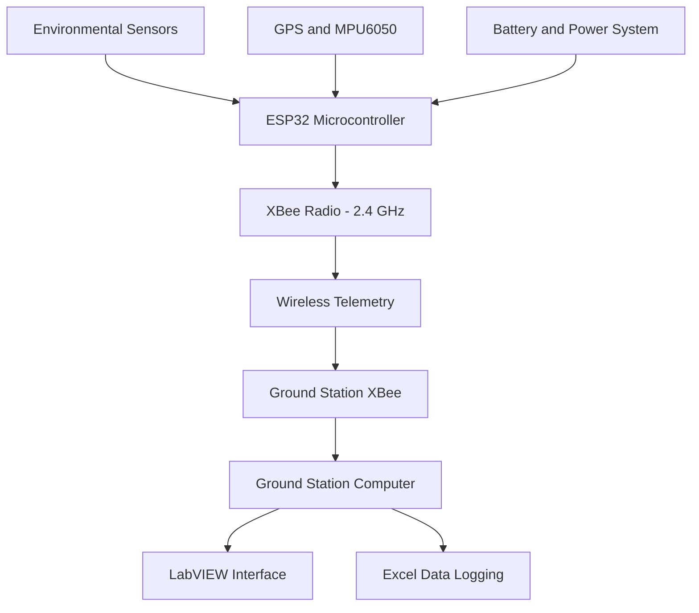

# Atmospheric Measurement Using CanSat

**Year 1 Team Engineering Project**  
**Team:** The Fourth Level of Hell

## Overview

This project involved the design and development of a CanSat (Can-sized Satellite) prototype for atmospheric measurement and environmental data collection.

The system integrates multiple sensors with an ESP32 microcontroller to collect atmospheric and flight-related data, including temperature, humidity, atmospheric pressure, gas measurements, GPS coordinates, and orientation.

Collected data is transmitted wirelessly to a ground station using XBee communication at **1-second intervals**, where it can be monitored, visualized, and recorded.

The project covers the development of an integrated aerospace system, including mechanical structure, sensor integration, embedded software, wireless communication, electrical power management, and ground station development.

## Mission Objectives

- **Atmospheric Monitoring:** Collect temperature, humidity, pressure, and gas-related measurements.
- **Real-Time Telemetry:** Transmit sensor measurements and GPS data to the ground station every second.
- **Ground Station Interface:** Visualize incoming telemetry through a graphical user interface and record measurement data.
- **Power Management:** Design a power system targeting at least 2 hours of operation.

## System Architecture



## Hardware Components

| Component | Model | Function |
|---|---|---|
| Microcontroller | ESP32-WROOM-32 | Sensor data acquisition and telemetry processing |
| GPS | NEO-6M | Position, altitude, and GPS data |
| IMU | MPU6050 | 3-axis accelerometer and gyroscope measurements |
| Temperature & Humidity | DHT22 | Environmental temperature and humidity |
| Pressure Sensor | BMP180 | Atmospheric pressure and altitude estimation |
| Gas Sensor | MQ-2 | Smoke and combustible gas detection |
| Gas Sensor | MQ-9 | Carbon monoxide and combustible gas detection |
| Real-Time Clock | DS3231 | Timekeeping |
| Wireless Communication | XBee Series 2C | Wireless telemetry transmission |
| Power Source | 18650 Li-ion Battery | Electrical power supply |

## Mechanical Design

The CanSat structure was designed using **3D modeling and PLA filament fabrication**.

Key design specifications:
- Height: 265 mm
- Diameter: 120 mm
- Material: PLA filament
- Modular internal arrangement for electronic components, sensors, and battery installation.

The mechanical subsystem was designed to house and secure the electronic components while providing access to the surrounding atmosphere for sensor measurements.

## Embedded Flight Software

The flight software was developed for the ESP32 using the Arduino development environment and C/C++.

Main functions include:
- Initialize and monitor connected sensors.
- Acquire environmental and flight-related measurements.
- Collect GPS coordinates and orientation data.
- Organize sensor readings into structured telemetry packets.
- Transmit telemetry to the ground station through XBee.
- Update and transmit data at 1-second intervals.

### Telemetry Data

The telemetry packet contains the following fields:

```text
TEAM_ID
PACKET_COUNT
STATUS
GPS_ALTITUDE
GPS_LATITUDE
GPS_LONGITUDE
ALTITUDE_BMP
TILT_X
TILT_Y
CARBON_MONOXIDE
METHANE
SMOKE
TEMPERATURE
HUMIDITY
PRESSURE
```

## Wireless Communication

The system uses XBee Series 2C modules operating at **2.4 GHz** for communication between the CanSat payload and ground station.

Communication configuration:
- Frequency: 2.4 GHz
- Serial baud rate: 9600 bps
- Network ID (NETID): 4
- Configuration: Coordinator and End Device
- Telemetry transmission interval: 1 second

The communication subsystem enables wireless transmission of telemetry throughout the mission.

## Ground Station and Data Visualization

The ground station receives telemetry from the CanSat through an XBee radio connected to a computer.

The interface and data processing workflow are designed to:
- Receive and interpret incoming telemetry packets.
- Display sensor measurements in real time.
- Visualize measurement trends through graphs.
- Record collected data for subsequent analysis.

**Software used:**
- LabVIEW Community Edition – Ground station interface and visualization.
- Microsoft Excel – Data logging and tabular analysis.

## Testing and Verification

The following results were documented in the team's project poster.

| Subsystem | Testing | Result |
|---|---|---|
| Mechanical | Rooftop drop test | Failed |
| Communication | XBee telemetry transmission and ground station packet parsing | Passed |
| Sensors | Sensor integration and acquisition testing | Passed |
| Flight Software | Sensor data collection and packet ordering | Passed |
| Electrical Power | 2-hour battery performance test | Passed |
| Ground Station | Telemetry visualization and graph plotting | Passed |

**Engineering note:** The mechanical drop test did not pass, indicating that the mechanical and descent system required further improvement and validation.

## Technologies and Tools

- **Programming:** C/C++, Arduino IDE
- **Microcontroller:** ESP32
- **Sensors:** GPS, IMU, temperature, humidity, pressure, and gas sensors
- **Communication:** XBee, 2.4 GHz
- **Ground Station:** LabVIEW, Microsoft Excel
- **Mechanical Design:** 3D CAD, PLA 3D printing
- **Electronics:** PCB design, sensor integration, power management

## Project Background

This was a collaborative first-year engineering team project that introduced the system-level engineering process through the development of a CanSat prototype.

The project provided practical experience in integrating mechanical, electrical, embedded software, communication, and ground station subsystems into a single engineering system.

---

**Team:** The Fourth Level of Hell  
**Project:** Atmospheric Measurement CanSat
